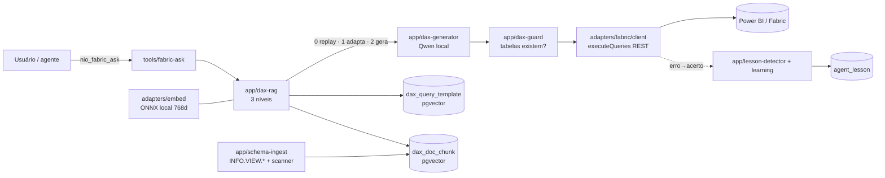

# Arquitetura — Fabric / Power BI / RAG de DAX / Aprendizado

> **Escopo:** o subsistema que deixa o agente consultar modelos semânticos do Power BI/Fabric
> (somente leitura) e aprender com os próprios erros. Cerca de 3.700 linhas, antes sem doc.
> Fonte da verdade é o código — este doc é o mapa; cada arquivo tem o porquê no cabeçalho.

## Visão

## Camadas

| Camada | Arquivos | Papel |
|---|---|---|
| `core/` | `fabric.ts`, `rag.ts`, `learning.ts` | Ports puros (`FabricGateway`, `DocIndex`, `DaxMemory`, `EmbeddingProvider`). Contrato **nunca lança**: falha vira `{ status }`. |
| `adapters/fabric/` | `client`, `token`, `device-code`, `refresh-store`, `scanner`, `query-metrics` | REST do Power BI. `token.ts` escolhe o grant; `scanner.ts` é a única rota que entrega a fórmula DAX das medidas. |
| `adapters/powerbi/` | `local-endpoint` | Descobre a porta efêmera do Analysis Services do Power BI Desktop (modo local, `NIO_PBI_LOCAL`). |
| `adapters/embed/` | `local-embedder` | Encoder ONNX em CPU (`multilingual-e5-base`, 768 dims). Dependência **opcional**. |
| `adapters/pg/` | repositórios de `dax_*` e `agent_lesson` | pgvector (índice HNSW). Migrations `0010` e `0011`. |
| `app/` | `dax-rag`, `dax-generator`, `dax-guard`, `schema-*`, `scan-to-schema`, `measure-lookup`, `rag-templates`, `lesson-*`, `learning` | Orquestração e regras puras. |
| `tools/` + `cli/` | `fabric-*.ts`, `pbi-local.ts`, `commands/fabric*.ts` | Superfície MCP (`nio_fabric_*`) e CLI (`nio fabric`). |

## Autenticação (dois grants, auto-selecionados)

| Condição | Grant | Observação |
|---|---|---|
| `NIO_FABRIC_USERNAME` + `NIO_FABRIC_PASSWORD` | ROPC (`password`) | Respeita RLS, mas o Entra recusa com MFA/Conditional Access (`AADSTS50126`). |
| `nio fabric login` | Device Code (RFC 8628) | Token de usuário real, convive com MFA e aplica RLS. Refresh token em `~/.nio/fabric-auth.json` (chmod do dono, fora do `config.env`). |
| Nada acima | Service principal (`client_credentials`) | Não executa query em dataset com RLS — limite da Microsoft, não bug. 401 aqui = RLS/tenant. |

Segredos só do env; token só em memória. Env vars: ver `.env.example` (seção Fabric).

## Os três níveis do `fabric_ask` (`app/dax-rag.ts`)

0. **Replay** — `question_hash` bate (pergunta normalizada + dataset): executa o DAX guardado literal.
1. **Adapta** — vizinho por cosseno ≥ limiar: o template é *base*, o modelo ajusta os parâmetros.
2. **Gera** — abaixo do limiar: contexto da doc + inventário do schema + geração completa.

**Invariante:** template achado por *similaridade* nunca executa sem adaptação. Medido: perguntas
erradas pontuam 0,955–0,965, acima de paráfrases legítimas (0,928), e o Fabric valida sintaxe, não
intenção — o DAX errado roda e devolve números errados em silêncio. Só o hit por hash replica.

## Grounding e guarda

- `schema-ingest` lê o modelo via `INFO.VIEW.*` (REST, sem XMLA), chunka e embeda. Idempotente: o `ref` é o hash do conteúdo.
- `INFO.VIEW.MEASURES()` devolve `[Expression]` nulo neste tenant; a fórmula vem do `scanner` admin
  (exige duas configurações de locatário ligadas para o SP).
- `schema-search` sempre injeta o **inventário de tabelas** (cabe em duas linhas) e usa top-k só para medidas/colunas.
- `dax-guard` confere os nomes de tabela contra o inventário **antes** de gastar request (limite: 120 req/min).

## Aprendizado contínuo

`lesson-detector` (puro, sem LLM) detecta o par "errou → acertou" da mesma tool a partir do stream;
`learning` embeda e grava em `agent_lesson`; no turno seguinte recupera lições parecidas e injeta como
**pista**. Nunca lança, nunca bloqueia o turno. `query-metrics` conta o resultado das consultas
(só a categoria, nunca o DAX) para medir se uma correção funcionou; `NIO_METRICS=0` desliga.

## Limites conhecidos

- Trocar de modelo de embedding muda a dimensão → nova migration + reingestão total.
- Sem pgvector ≥ 0.5.0, trocar o índice HNSW por `ivfflat` (nota na migration `0010`).
- O modo local depende do Power BI Desktop aberto; a porta muda a cada abertura.
